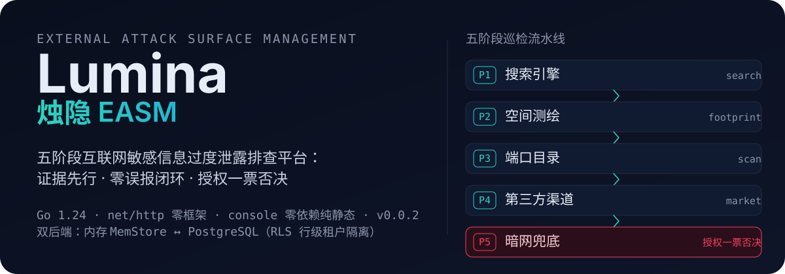
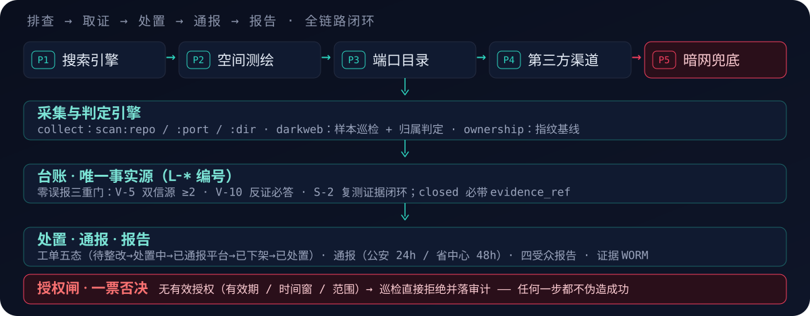

<p align="center">
  
</p>

<div align="center">

**Lumina · 烛隐 EASM** —— 互联网敏感信息过度泄露排查 / 外部攻击面管理平台

[](go.mod)
[](https://github.com/anyeduke11/lumina-easm/actions)
[](https://github.com/anyeduke11/lumina-easm/releases)
[](LICENSE)

</div>

---

## 这是什么

监管五阶段驱动的**外部攻击面排查平台**：对组织的互联网敏感信息过度泄露进行系统化排查、取证、处置与合规报送，覆盖**搜索引擎 → 空间测绘 → 端口目录 → 第三方渠道 → 暗网兜底**五条巡检线。

平台把「证据」放在第一位：每一条台账结论都可回溯到原始证据（WORM 固化、哈希锚定），零误报三重门与授权一票否决保证**结论可验证、闭环不虚报**。

## 为什么不同

| 设计公理 | 在代码中的落点 |
| --- | --- |
| **AX-1** 数据是地基（图谱） | 资产入账即投影为图谱实体，图谱是资产清单的母体 |
| **AX-2** 确定性发现 + AI 判断 | 平台只做确定性规则/CLI；敏感识别走 22 条规则，AI 未接入（ENH-10） |
| **AX-3** 一切皆可验证 | 证据先行：`evidence.Store` WORM，`raw_ref`/`snapshot_ref` 可回溯；台账闭环必须经复测 `Verify`，未装配 verifier 返回 501——**禁止伪造闭环** |
| **AX-4** 持续闭环 | 台账四态状态机；处置工单五态（待整改→处置中→已通报平台→已下架→已处置），跳步/回退/终态出边全拒 |
| **AX-5** 人在环可审计 | 四类高危动作（爆破/主动扫描/跨租户读取/对外通报）强制人工确认；audit 仅追加；通报三要素列锁定 |
| **AX-6** 一切皆插件 | 平台零扫描逻辑，工具经插件契约注册，CLI 子进程为原定契约 |

三个最容易造假的地方，全部被闸卡死：

- **授权一票否决**：无有效授权（有效期/时间窗/范围）→ 巡检直接拒绝并落审计，任何一步不伪造成功。
- **零误报三重门**：`严重`须 ≥2 独立信源（V-5）＋ 反证必答（V-10）＋ 复测证据闭环（S-2）；不满足自动降级并留痕。
- **无法静默降级**：env 设置但装载失败一律 `log.Fatalf`；可选能力未装配返回 501 + machine-readable code，不返回空数据。

## 工作原理

<p align="center">
  
</p>

五阶段巡检线（口径唯一：步骤数 4/4/5/3/4）：

| 阶段 | 内容 | 入口 |
| --- | --- | --- |
| P1 搜索引擎 | 主动搜索 + 语法库检索，发现暴露面 | `search` |
| P2 空间测绘 | 域名/IP/证书/端口关联，指纹基线 | `footprint` |
| P3 端口目录 | 主动扫描（repo/port/dir），授权闸前置 | `collect` |
| P4 第三方渠道 | 代码托管/GitHub 泄露源持续监控 | `collect` |
| P5 暗网兜底 | 样本巡检 → 归属判定 → 量级区间 → 交易链路 → 线索包固化 | `darkweb` |

采集结果统一归一为 `easm.candidate.v1`，判定命中的写入台账 `L-*`；台账是唯一事实源，三重门过滤后流向处置工单、线索通报（公安 24h / 省通报中心 48h，回执才置已报送）与四受众报告（管理层/运营/合规/红队）。

## 快速开始

前置：Go 1.24。

```bash
git clone https://github.com/anyeduke11/lumina-easm.git
cd lumina-easm

make run        # 纯内存模式起 server（dev 令牌演示，默认 :8080）
```

打开 `http://localhost:8080` 即可使用 console。纯内存模式不预置客户，先用 API 建租户（`POST /v1/tenants`）。Dev 令牌仅本地有效：

```bash
EASM_DEV_TOKENS="tok-admin:R7:*,tok-ops:R1:t-a,tok-ro:R3:*" make run
```

PostgreSQL 模式（RLS 行级租户隔离）：

```bash
make dev-up     # docker compose：PG / Redis / Neo4j
make migrate    # 应用 migrations/001–019
make run-local  # EASM_PG_DSN 模式
```

## 仓库结构

```text
platform/services/cmd/server      REST /v1/* + MCP /mcp + console 静态面
platform/services/cmd/worker      Temporal activity worker
platform/services/internal/       业务域分包（sweep/ledger/darkweb/workorder/notice/...）
console/                          零依赖纯静态前端（index.html + app.js + easm-live.js）
migrations/                       001–019 顺序 SQL（含 RLS 与角色）
scripts/                          端到端验证 / 压测 / 许可证取证 / 追溯对账
deploy/                           docker-compose.dev.yml
.github/workflows/ci.yml          go vet / build / test + 追溯对账 + lint
```

## 测试与验证

```bash
make test        # go test ./... -count=1
make trace       # C-1 追溯对账：每个 Go 包注释须携带 FR/WP/IR/CR/ENH 编号
make test-integ  # 集成测试（需 EASM_PG_DSN，easm_app 角色）
make verify      # 收口套件：集成回归 + 端到端三件套 + 授权 SOP 预演
```

端到端脚本要求 server 监听 `:18080`：`live-smoke.py`（前端接线回归）、`kb-smoke.sh`、`authz-sop-drill.sh`、`workorder-live.sh` / `notice-live.sh` / `darkweb-demo.sh` 等。

## v0.0.1 边界（已知未交付项）

- **认证**：生产 OIDC 未接入（ENH-07），dev 静态令牌仅本地演示用。
- **暗网 feed**：真实暗网数据源为软阻塞（G8-03），当前以模拟 fixture 兜底入口。
- **报告导出**：PDF 为遗留能力，本期仅交付 Markdown / JSON。
- **真实通报通道**：对外报送（G8-02）未触达，系统生成单号+模板材料，「已报送」仅能由回执录入。

## License

[Apache License 2.0](LICENSE)
